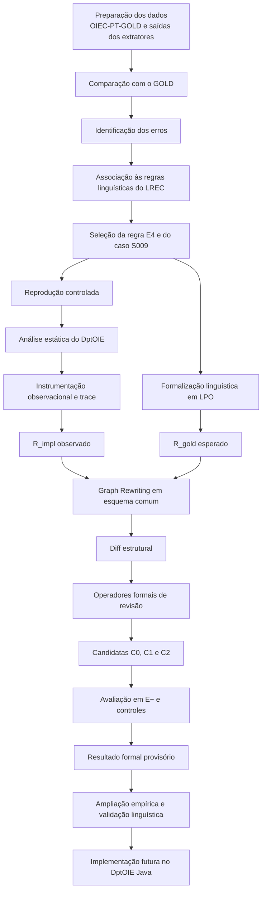

# Dossiê para a qualificação — experimento E4 no DptOIE

## Finalidade deste documento

Este dossiê consolida, em uma narrativa única, o trabalho realizado sobre a regra E4 no DptOIE. Ele foi preparado para fornecer contexto a uma pessoa ou a um sistema de apoio à escrita da qualificação sem exigir que os artefatos sejam interpretados isoladamente.

O documento reúne:

- o problema científico;
- a arquitetura metodológica;
- os dados e o caso piloto;
- a reprodução do erro;
- a análise do código e a proveniência por execução;
- a representação em Graph Rewriting;
- a primeira experiência de Theory Revision;
- os resultados de C0, C1 e C2;
- as limitações metodológicas;
- o estado atual da pesquisa;
- os próximos passos;
- o índice dos documentos, notebooks, planilhas e evidências.

### Estado do repositório no momento da consolidação

- **Branch:** `modelagem-graph-rewriting-e4`
- **HEAD:** `7f3fef2` — `experiment: implement formal E4 theory revision v4`
- **Commit-base do código original do DptOIE:** `1a5ef708b1ed0a888aac63a7a4512af3cccad315`
- **Data desta consolidação:** 2026-11-03
- **Escopo científico atual:** E4; E9 permanece fora desta análise.
- **Código Java:** a revisão v4 não foi implementada no DptOIE Java.

As planilhas de rastreabilidade e seus exportadores existem no working tree, mas ainda não estavam versionados no momento desta consolidação. Esse estatuto deve ser informado quando elas forem citadas como artefatos de apresentação ou auditoria.

---

## 1. Resumo executivo

A pesquisa investiga como transformar regras linguísticas de avaliação de Open Information Extraction em objetos formais comparáveis às regras efetivamente realizadas por um extrator. O estudo piloto foi delimitado à regra E4:

> “Se o verbo rege uma preposição, ela deve ser incluída em REL.”

O caso piloto é a extração S009-A41:

```text
Sentença:
Catalano voltou para a área depois de viver em Londres e em Glasgow,
onde estudou design de jóias na Glasgow School of Art.

DptOIE: (Catalano, voltou, para a área)
GOLD:   (Catalano, voltou para, a área)
```

O erro foi reproduzido de forma controlada. O código-fonte original foi compilado e demonstrou comportamento equivalente ao JAR distribuído para esse caso. Em seguida, uma instrumentação exclusivamente observacional mostrou a cadeia que produziu a fronteira entre REL e o argumento:

```text
Catalano → sujeito
voltou → núcleo de REL
REL final → [voltou]
para → não foi visitado durante a construção de REL
área → iniciou o argumento como filha nmod de voltou
para → acionou o intervalo [3,5]
intervalo → adicionou [para, a, área]
ARG2 do código / ARG1 da pesquisa → [para, a, área]
extração final → (Catalano, voltou, para a área)
```

Com base nessa evidência, foram representadas no mesmo framework de Graph Rewriting:

- `R_impl_observado_E4_S009`: construção observada, de `G_base` para `G_impl`;
- `R_gold_esperado_E4_S009`: construção esperada segundo E4, de `G_base` para `G_gold`;
- `R_gold_correcao_E4`: transformação corretiva de `G_impl` para `G_gold`.

O resultado estrutural central foi:

```text
G_impl: ARG1(e,p)
G_gold: REL(e,p)
```

Para `p=para`, a implementação modelada associa a preposição ao argumento, enquanto o estado esperado a associa a REL.

Na Theory Revision v4, três candidatas foram derivadas de uma regra formal imutável por operadores explícitos:

- **C0:** transfere a preposição com base no diff e no intervalo, sem nova guarda linguística;
- **C1:** condiciona a transferência a `case(p,n) ∧ nmod(n,v)`;
- **C2:** condiciona a transferência a um status provisório de `Rege(v,p)`.

Em um conjunto fechado de oito outputs — quatro E− da mesma sentença S009 e quatro controles de três outras sentenças — foram realizadas 24 aplicações formais:

- C0: cinco acertos exploratórios e três sobreaplicações;
- C1: seis acertos exploratórios e duas sobreaplicações;
- C2: oito acertos exploratórios condicionais.

O resultado de C2 depende de valores de regência fornecidos manualmente e parcialmente fundamentados pelo GOLD. Portanto, o trabalho atual demonstra uma **prova de conceito formal, explícita e rastreável**, mas não uma revisão generalizada do DptOIE.

---

## 2. Problema científico

O ponto de partida é uma divergência entre a especificação linguística e o comportamento observado de um extrator OpenIE.

A cadeia metodológica adotada é:

```text
erro observado
→ regra linguística violada
→ proveniência da decisão no extrator
→ representação de R_impl
→ representação de R_gold
→ diff estrutural
→ operadores de revisão
→ regras candidatas
→ avaliação formal e empírica
```

O problema não é simplesmente corrigir uma string de saída. É necessário responder:

1. qual mecanismo do extrator produziu a fronteira observada;
2. como esse mecanismo pode ser representado formalmente;
3. como representar a regra esperada no mesmo formalismo;
4. quais diferenças estruturais existem entre as regras;
5. quais edições produzem candidatas rastreáveis;
6. quais candidatas corrigem E− sem alterar indevidamente controles ou E+;
7. até onde os resultados podem ser generalizados.

### Questão central do estudo piloto

Como identificar, representar e revisar formalmente o mecanismo observado do DptOIE responsável pela fronteira `REL/ARG1` no caso E4/S009, preservando rastreabilidade entre especificação linguística, código, execução, modelo formal e avaliação?

---

## 3. Qualificadores epistemológicos obrigatórios

Toda redação derivada deste dossiê deve distinguir quatro categorias.

| Categoria | Significado |
|---|---|
| **FATO OBSERVADO** | Sustentado diretamente por planilha, código, execução, trace ou artefato preservado. |
| **DECISÃO DE MODELAGEM** | Escolha explícita para representar o fato no formalismo. |
| **HIPÓTESE** | Explicação ou generalização ainda não confirmada. |
| **NÃO DETERMINADO** | Informação que os dados atuais não permitem estabelecer. |

Dois cuidados são centrais:

- o catálogo de regras orienta a busca, mas não comprova qual caminho foi executado;
- uma relação `case` ou `nmod` no parse não comprova, isoladamente, regência verbal.

---

## 4. Arquitetura metodológica da pesquisa



### Dois fluxos que convergem

| Fluxo | Origem | Produto |
|---|---|---|
| **Especificação linguística** | Regras do LREC, formalização e GOLD | `R_gold` |
| **Evidência empírica e operacional** | Corpus, saída do extrator, código e trace | `R_impl` |

Os dois objetos são levados a uma representação comum em Graph Rewriting. A comparação estrutural orienta os operadores de revisão. As candidatas resultantes são avaliadas, mas uma regra somente poderá ser considerada generalizada após ampliação empírica, validação linguística e teste independente.

---

## 5. Regra E4

### Linguagem natural

> “Se o verbo rege uma preposição, ela deve ser incluída em REL.”

### Lógica de Primeira Ordem

\[
\forall e\;\forall v\;\forall p\;
[(EmREL(v,e) \land Rege(v,p)) \rightarrow EmREL(p,e)]
\]

Onde:

- `EmREL(x,e)`: o elemento `x` integra REL da extração `e`;
- `Rege(v,p)`: o verbo `v` rege a preposição `p`.

### Limite da formalização

A fórmula exige a presença de `p` em REL quando as premissas são satisfeitas. Ela não determina, sozinha:

- como reconhecer computacionalmente `Rege(v,p)`;
- como localizar `p` no parse;
- se `p` deve ser removido de outro componente;
- como preservar os demais tokens do argumento;
- qual mecanismo do DptOIE produziu a fronteira incorreta.

Esses elementos pertencem à operacionalização e precisam de evidência adicional.

---

## 6. Dados e recorte experimental

### Fonte principal

O recorte experimental está em:

`research/experimento/semana5_experimento_OIEC_PT_GOLD (3)(1).xlsx`

Ele contém sentenças, saídas de extratores, GOLD e análises. Não se deve afirmar que essa planilha corresponda ao corpus OIEC-PT-GOLD completo; ela é o recorte disponível no workspace.

### Caso piloto

O caso principal é S009-A41. A mesma sentença possui outras três extrações do DptOIE associadas a E4: A42, A43 e A44.

| Caso | Papel no estudo |
|---|---|
| S009-A41 | piloto com proveniência operacional confirmada |
| S009-A42 | variante da mesma sentença |
| S009-A43 | variante com correção de E4, mas divergências residuais de E3/S3 |
| S009-A44 | variante com correção de E4, mas divergências residuais de E3/S3 |

As quatro ocorrências E− não representam quatro contextos sentenciais independentes. Elas compartilham a mesma sentença, o mesmo verbo `voltou` e a mesma preposição `para`.

### Controles modelados

Foram reproduzidas três sentenças adicionais, gerando 15 extrações baseline. Quatro outputs foram modelados como controles candidatos:

| Caso | Contexto preliminar | Papel experimental |
|---|---|---|
| S005-A28 | complemento/conteúdo ou finalidade | detectar transferência excessiva |
| S010-A51 | construção locativa | detectar transferência excessiva |
| S010-A52 | locativo e oração de finalidade | detectar transferência excessiva |
| S003-A20 | complemento de adjetivo em construção copular | detectar transferência excessiva |

Esses controles não são E+ específicos de E4. Eles testam principalmente a **não aplicação** de uma revisão em contextos nos quais a preposição deve permanecer no argumento segundo os dados modelados.

### Cobertura utilizada no v4

```text
8 outputs modelados
├── 4 E− de S009, uma única sentença
└── 4 controles, distribuídos em S003, S005 e S010

24 aplicações formais
└── 3 candidatas × 8 outputs

11 outputs baseline ainda não modelados
```

---

## 7. Reprodução controlada de S009

### Execução com o JAR distribuído

A extração piloto foi reproduzida uma única vez com o JAR distribuído e o modelo de dependências oficialmente disponibilizado no momento do experimento.

| Item | Valor |
|---|---|
| Java | Eclipse Temurin `1.8.0_504` |
| Parâmetros | `CC=false`, `SC=false`, `appositive=0` |
| `DptOIE.jar` SHA-256 | `5ff8246cc170537ce7ccb7e1640872564b1534f2ab6c0dbb00ea264468b36d52` |
| POS model SHA-256 | `3025001fb828b7bb73b7f7de6cf6e303126e23aa4f175c8e7f1ad69988a8635b` |
| Dependency model SHA-256 | `341e6b5bfc2288b8e7991ee746b2517b02dfb2ef7e540b3666f2b969bd4db30d` |
| Exit code | `0` |
| Extrações produzidas | `7` |
| Classificação do piloto | `REPRODUZIDA EXATAMENTE` |

Essa execução não é denominada reprodução histórica exata: não está comprovado que o modelo atual seja o mesmo usado na execução histórica que originou S009.

### Build contemporâneo do código original

O código-fonte original, sem mudanças em `src/` ou `pom.xml`, foi compilado com Java 8 e Maven 3.9.16. O build foi contemporâneo, não histórico.

O JAR com dependências produzido tinha SHA-256:

`8cc9e723dd8a563bfaf82b8bb37ba9ee4223220366d18983503b4d2596615e5e`

Para S009:

- foram produzidas sete extrações nas duas execuções;
- a extração piloto apareceu exatamente nas duas;
- o parse crítico foi idêntico;
- `output_DP.conll` foi byte a byte idêntico;
- as sete linhas funcionais dos CSVs foram textualmente idênticas;
- as diferenças ficaram restritas a cabeçalho/encoding periférico.

A conclusão permitida é **comportamento equivalente para o caso piloto**, não equivalência funcional geral entre os JARs.

---

## 8. Parse crítico observado

| ID | FORM | POS | HEAD | DEPREL |
|---:|---|---|---:|---|
| 1 | Catalano | PNOUN | 2 | nsubj |
| 2 | voltou | VERB | 0 | root |
| 3 | para | ADP | 5 | case |
| 4 | a | DET | 5 | det |
| 5 | área | NOUN | 2 | nmod |

Uma forma descritiva das dependências é:

```text
Catalano --nsubj--> voltou
área     --nmod----> voltou
para     --case----> área
a        --det-----> área
```

Essas relações são propriedades observadas do parse. Elas não devem ser convertidas automaticamente em uma afirmação de regência verbal.

---

## 9. Análise estática e hipóteses D02/D03

A leitura estática localizou:

- entrada: `extrai_clausulas.Main.main`;
- parser: `pre_processamento.PreProcessamento`;
- tokens/dependências: `Token` e `Sentence`;
- sujeito: `Extracao1.buscaSujeito`;
- REL: `Extracao1.buscaRelacao`;
- segundo argumento: `Extracao1.extraiClausulas` e `retornaTokenConcatenadoSujeitoArgumentos`;
- reunião dos componentes: `SujeitoRelacaoArgumentos` e serialização em `Main.main`.

O catálogo contém:

- **D02:** identificação de REL por DFS após a seleção do sujeito;
- **D03:** identificação do segundo argumento a partir de filhos da relação.

D02 e D03 foram tratadas inicialmente como **hipóteses de proveniência**. O catálogo não foi usado como prova de que essas regras causaram o resultado.

### Convenção de nomes

Na pesquisa e nas planilhas, os componentes são frequentemente denominados `ARG0`, `REL` e `ARG1`. No código e no catálogo do DptOIE, o componente depois de REL pode aparecer como `arg2` ou `ARG2`. Neste dossiê, `ARG1` significa o segundo argumento da tripla segundo o formalismo da pesquisa.

---

## 10. Instrumentação e proveniência operacional

Foi implementado um trace observacional com as seguintes propriedades:

- desabilitado por padrão;
- habilitado somente por `-Ddptoie.e4trace=true`;
- escrito em `stderr`;
- linhas iniciadas por `[E4TRACE]`;
- contador monotônico `seq`;
- nenhuma mudança intencional em condições, DFS, coleções, dependências ou resultados.

### Validação de não interferência

Com o trace desligado:

- a execução terminou com exit code `0`;
- produziu sete extrações;
- manteve a extração piloto;
- CSV funcional e arquivos intermediários foram idênticos ao baseline;
- foram produzidas zero linhas `[E4TRACE]`.

A classificação foi:

`INSTRUMENTAÇÃO NÃO ALTEROU O COMPORTAMENTO OBSERVADO`

Essa conclusão é limitada a S009 e às condições testadas.

### Execução trace-on

- commit instrumentado: `db6af3e90c9a99ad2a61f6f0327e89503aeb63cc`;
- JAR instrumentado SHA-256: `3c4b9a72dafe03c41045367be437c638eabeb9e71a1bf2edab7ce329c826290d`;
- uma execução;
- exit code `0`;
- 133 eventos, com `seq=1..133`;
- outputs funcionais byte a byte idênticos aos do trace-off.

### Cadeia observada para a extração piloto

| Seq/evento | Evidência |
|---|---|
| `1 — SUBJECT_SELECTED` | `Catalano`, token 1, foi selecionado como sujeito. |
| `2 — REL_CORE_INITIALIZED` | `voltou`, token 2, foi inicializado como núcleo de REL. |
| `13 — REL_CORE_AFTER_REEVALUATION` | o núcleo permaneceu no token 2. |
| `14 — REL_FINAL_AFTER_BUILD` | REL final continha somente `[2]=[voltou]`. |
| `3..12 — travessia de REL` | `para`, token 3, não foi visitado nessa travessia. |
| `16 — ARG_CORE_CHILD_EXAMINED` | `área`, token 5, foi examinada como filha de `voltou`, com `deprel=nmod`. |
| `17 — ARG_CONCAT_BEGIN` | a concatenação começou a partir de `área`. |
| `18..19` | `para`, filho de `área`, foi examinado e acionou o intervalo `[3,5]`. |
| `20..22` | a mesma operação adicionou `para`, `a` e `área`. |
| `24..26 — ARG2_ADDED` | o argumento `[3,4,5]` foi adicionado. |
| `127 — FINAL_EXTRACTION_BEFORE_CSV` | o mesmo objeto apareceu em `(Catalano, voltou, para a área)`. |

### O trace demonstra

- `para` não foi visitado durante a construção observada de REL;
- a inclusão no argumento ocorreu pela operação de intervalo;
- os tokens 3, 4 e 5 foram adicionados pela mesma operação;
- o argumento criado foi usado na extração final.

### O trace não demonstra

- que todo `case` seja enviado ao argumento;
- que `case` seja a condição que acionou a operação;
- que `para` tenha sido examinado e rejeitado por REL;
- uma regra geral válida para todo o DptOIE;
- uma revisão de E4;
- causalidade para as variantes A42–A44, cuja proveniência não foi instrumentada individualmente.

---

## 11. Representação em Graph Rewriting

### 11.1 Três objetos distintos

Para evitar comparar uma regra de construção com uma regra de correção, foram definidos três objetos.

#### `R_impl_observado_E4_S009`

```text
G_base → G_impl
```

Representa somente o comportamento sustentado pela evidência de S009.

Resultado:

```text
REL  = [voltou]
ARG1 = [para, a, área]
```

#### `R_gold_esperado_E4_S009`

```text
G_base → G_gold
```

Representa a construção esperada segundo E4.

Resultado:

```text
REL  = [voltou, para]
ARG1 = [a, área]
```

#### `R_gold_correcao_E4`

```text
G_impl → G_gold
```

É a transformação corretiva que remove `p` de ARG1 e o adiciona a REL. Ela demonstra a passagem entre os estados modelados, mas não é apresentada como Theory Revision validada.

### 11.2 Estado inicial comum `G_base`

`G_base` contém:

- extração `e`;
- tokens `Catalano`, `voltou`, `para`, `a` e `área`;
- dependências `nsubj`, `nmod`, `case` e `det`;
- conhecimento linguístico `Rege(voltou,para)`;
- `Catalano` em ARG0;
- `voltou` como candidato a núcleo de REL;
- nenhum efeito de REL/ARG1 ainda aplicado.

`nsubj` é contexto observado, mas não uma guarda específica da divergência E4.

### 11.3 Camadas do grafo

- `DEPENDENCY`: relações do parse;
- `LINGUISTIC`: conhecimento como `Rege(v,p)`;
- `OPENIE`: associações com ARG0, REL e ARG1;
- `CONSTRUCTION`: candidatos, intervalos e operações;
- `PROVENANCE`: evidências de execução, sem serem convertidas automaticamente em guardas.

### 11.4 Diff estrutural central

| Dimensão | Implementação observada | GOLD esperado |
|---|---|---|
| Guarda distintiva | `nmod`, filho à esquerda e intervalo disponível | `Rege(v,p)` |
| Verbo | `REL(e,v)` | `REL(e,v)` |
| Preposição | `ARG1(e,p)` | `REL(e,p)` |
| Determinante e nome | `ARG1(e,d)`, `ARG1(e,n)` | `ARG1(e,d)`, `ARG1(e,n)` |

Resultado central:

\[
ARG1(e,p)\quad\text{na implementação modelada}
\qquad\times\qquad
REL(e,p)\quad\text{no estado esperado}
\]

Para S009, `p=para`.

### 11.5 Validação da transformação corretiva

O notebook v2 registrou que a transformação corretiva:

- encontrou o match em `G_impl`;
- removeu `ARG1(e,p)`;
- adicionou `REL(e,p)`;
- produziu assinatura OpenIE equivalente a `G_gold`.

Resultado armazenado:

`CORRECTION VALIDATION: True`

Isso valida a consistência interna da transformação para a instância. Não valida uma correção geral do sistema.

---

## 12. Preparação dos controles

As execuções S003, S005 e S010 usaram:

- o `DptOIE.jar` distribuído original;
- os mesmos modelos de POS e dependência;
- Java `1.8.0_504`;
- `CC=false`, `SC=false`, `appositive=0`;
- trace desabilitado.

Foram preservadas todas as 15 extrações produzidas. Quatro outputs foram selecionados para modelagem inicial de não aplicação.

### Interpretação permitida

Os casos ajudam a detectar sobreaplicação: uma candidata inadequada pode mover para REL preposições que o baseline e o GOLD mantêm no argumento.

### Interpretação não permitida

Não se deve afirmar automaticamente que:

- são E+ específicos de E4;
- `Rege(v,p)` é falso apenas porque a preposição está no argumento;
- `case` prova ou refuta regência;
- a correspondência com o GOLD comprova correção linguística integral.

Existe ainda a diferença textual `en a`/`em a`, registrada como problema de serialização ou forma superficial que deve ser separada da avaliação das fronteiras.

---

## 13. Theory Revision v3 e sua auditoria

O v3 realizou uma primeira avaliação exploratória de C0, C1 e C2. A auditoria concluiu que a matriz de resultados era útil, mas a implementação tinha natureza principalmente procedural:

- C0/C1/C2 eram comportamentos implementados por branches;
- os operadores não transformavam objetos-regra completos;
- as fronteiras baseline eram conhecidas previamente;
- o intervalo não era usado integralmente como objeto operacional da construção;
- o custo era pré-atribuído, não calculado automaticamente do diff;
- `INDETERMINATE` não havia sido efetivamente testado;
- a regência era manual e parcialmente influenciada pelo GOLD.

A conclusão segura do v3 foi:

> Dadas fronteiras baseline conhecidas e uma classificação manual de regência, C2 transfere a preposição em S009 e preserva os quatro controles representados.

O v3 não demonstrou um mecanismo geral de edição de regras nem inferência operacional de regência. Essas limitações motivaram o protocolo v4.

---

## 14. Theory Revision v4

### 14.1 Objetivo

Demonstrar que C0, C1 e C2 podem ser obtidas por operadores explícitos de edição aplicados à regra formal `R_impl_observado_E4_S009_A41`, preservando imutabilidade, diff automático, custo, proveniência e linhagem.

### 14.2 Representação

O v4 implementou objetos formais imutáveis para:

- variáveis e contexto;
- guardas;
- expressões de conjuntos de tokens;
- efeitos;
- restrições;
- evidências;
- registros de edição;
- regras atômicas;
- branches e regras compostas.

O grafo usa `networkx.MultiDiGraph`, preservando arestas paralelas por chaves e camadas.

### 14.3 Operação de intervalo

A condição operacional modelada a partir do Java é:

```text
ARG_ROOT_ALLOWED(n)
AND FIRST_LEFT_CHILD(p,n)
AND order(p) < order(n)
```

O matcher deriva `p` como o primeiro filho à esquerda de `n` e calcula:

\[
I(p,n)=\{q\mid ordem(p)\leq ordem(q)\leq ordem(n)\}
\]

Para S009-A41:

```text
p = token 3, para
n = token 5, área
I(p,n) = [3,4,5] = [para,a,área]
```

O v4 usa efetivamente esse intervalo para construir o resultado. O token externo `U`, quando existente, é preservado separadamente.

### 14.4 Informações derivadas e fornecidas

#### Derivadas do grafo

- filhos e ordem;
- primeiro filho à esquerda `p`;
- dependências usadas pelas guardas;
- intervalo `I(p,n)`;
- branch aplicável;
- componentes resultantes.

#### Entradas experimentais

- núcleo candidato `v`;
- raízes candidatas `n`;
- ARG0 e REL anteriores à operação estudada;
- contribuição externa `U`;
- status provisório de `Rege(v,p)` e sua origem.

O GOLD fica no `EvaluationOracle` e é consultado após a aplicação. O executor não recebe GOLD nem o span esperado para construir a saída.

### 14.5 Operadores formais

| Operador | Papel |
|---|---|
| `ADD_GUARD` | acrescenta uma guarda genérica validada |
| `ADD_GUARD_REGE` | acrescenta a condição trivalorada de regência |
| `RESTRICT_INTERVAL` | restringe a operação à partição do intervalo |
| `CHANGE_COMPONENT` | muda o componente de um conjunto de tokens |
| `SPLIT_RULE` | cria branches especializados e fallback |

Cada operador recebe uma regra e devolve outra regra, sem alterar silenciosamente o objeto-pai. Cada movimento gera `EditRecord`.

---

## 15. Por que C0, C1 e C2 foram criadas

As três candidatas representam hipóteses crescentes, previamente justificadas pelas evidências disponíveis.

| Candidata | Pergunta investigada | Informação utilizada |
|---|---|---|
| **C0** | O diff estrutural e o intervalo são suficientes? | fronteira observada |
| **C1** | `case+nmod` distinguem quando transferir? | dependências do parse |
| **C2** | É necessária uma condição de regência? | regra linguística E4 |

Elas não constituem todas as revisões possíveis. O espaço foi deliberadamente limitado para evitar condições arbitrárias ou específicas de S009, como uma regra que memorizasse `voltou para`.

### C0

```text
RESTRICT_INTERVAL
→ CHANGE_COMPONENT(ARG1, REL, {p})
```

C0 transfere `p` sem acrescentar uma guarda linguística.

### C1

```text
ADD_GUARD(dep(p,n,case))
→ ADD_GUARD(dep(n,v,nmod))
→ RESTRICT_INTERVAL
→ CHANGE_COMPONENT(ARG1, REL, {p})
→ SPLIT_RULE(branch sintático, fallback)
```

C1 testa se as relações sintáticas presentes no parse são suficientes.

### C2

```text
ADD_GUARD_REGE(StatusRege=TRUE_PROVISIONAL)
→ RESTRICT_INTERVAL
→ CHANGE_COMPONENT(ARG1, REL, {p})
→ SPLIT_RULE(TRUE_PROVISIONAL, FALSE_PROVISIONAL, INDETERMINATE)
```

C2 incorpora a condição linguística de E4, mas recebe seu valor como entrada experimental.

---

## 16. Resultados formais do v4

### Integridade do experimento

- notebook: `research/graph_rewriting/experimento_v4_e4_theory_revision.ipynb`;
- SHA-256 do notebook executado: `bb7506602745d061ae113969c964f6c5fbfc6df85ca06a87a14eaaf125672cca`;
- 18 células, nove de código;
- células executadas em ordem `1..9`;
- nenhum output de erro;
- 31 asserções aprovadas;
- oito casos reais;
- 24 aplicações formais.

### Diff e custo automáticos

Foram usados pesos unitários definidos antes da avaliação.

| Candidata | Guardas +/− | Efeitos +/− | Intervalo | Restrições +/− | Split | Custo |
|---|---:|---:|---:|---:|---:|---:|
| C0 | 0/0 | 2/1 | 1 | 1/0 | 0 | 5 |
| C1 | 2/0 | 2/1 | 1 | 1/0 | 1 | 8 |
| C2 | 1/0 | 2/1 | 1 | 1/0 | 1 | 7 |

O custo mede distância estrutural segundo a métrica adotada. Ele não mede, sozinho, qualidade linguística e não prova minimalidade global.

### Matriz de resultados

| Caso | C0 | C1 | C2 |
|---|---|---|---|
| S009-A41 | `PASS_EXPLORATORY` | `PASS_EXPLORATORY` | `PASS_EXPLORATORY` |
| S009-A42 | `PASS_EXPLORATORY` | `PASS_EXPLORATORY` | `PASS_EXPLORATORY` |
| S009-A43 | `PASS_EXPLORATORY` | `PASS_EXPLORATORY` | `PASS_EXPLORATORY` |
| S009-A44 | `PASS_EXPLORATORY` | `PASS_EXPLORATORY` | `PASS_EXPLORATORY` |
| S005-A28 | `FAIL_OVERAPPLICATION` | `PASS_EXPLORATORY` | `PASS_EXPLORATORY` |
| S010-A51 | `FAIL_OVERAPPLICATION` | `FAIL_OVERAPPLICATION` | `PASS_EXPLORATORY` |
| S010-A52 | `FAIL_OVERAPPLICATION` | `FAIL_OVERAPPLICATION` | `PASS_EXPLORATORY` |
| S003-A20 | `PASS_EXPLORATORY` | `PASS_EXPLORATORY` | `PASS_EXPLORATORY` |

### Resultado global

| Candidata | Passes | Falhas | Classificação global |
|---|---:|---:|---|
| C0 | 5 | 3 | `FAIL_OVERAPPLICATION` |
| C1 | 6 | 2 | `FAIL_OVERAPPLICATION` |
| C2 | 8 condicionais | 0 no conjunto fechado | `PASS_EXPLORATORY` |

### Interpretação de cada candidata

#### C0 sobreaplica

C0 transfere preposições sempre que sua estrutura de intervalo casa. Além de corrigir S009, altera controles:

- transfere `para` em S005-A28;
- transfere `en` em S010-A51;
- transfere `en` e `para` em S010-A52.

Portanto, o diff estrutural sozinho não é condição seletiva suficiente.

#### C1 não distingue os locativos de S010

C1 preserva S005-A28 e S003-A20, mas transfere `en` em S010-A51 e S010-A52. Nesses casos, as condições `case(p,n) ∧ nmod(n,v)` também aparecem, embora a transferência não seja desejada no conjunto modelado.

Logo, `case+nmod` não distinguem, nesse conjunto, a construção direcional de S009 da construção locativa de S010.

#### C2 satisfaz condicionalmente o conjunto piloto

C2:

- transfere `para` nas quatro representações de S009 quando recebe `TRUE_PROVISIONAL`;
- preserva os quatro controles quando recebe `FALSE_PROVISIONAL`;
- preserva um fixture quando recebe `INDETERMINATE`.

Entretanto, C2 não descobre `Rege(v,p)`. Os status foram fornecidos manualmente e, nos casos reais atuais, o GOLD participou parcialmente de sua fundamentação.

### A43 e A44

Em A43 e A44, `PASS_EXPLORATORY` significa que o aspecto E4 foi corrigido. Não significa igualdade integral com o GOLD. Permanecem divergências associadas a E3/S3 e à delimitação de material oracional. A análise de qual outra regra linguística deve tratar esse complemento não foi concluída e requer confirmação específica, possivelmente com as linguistas. Esses casos também evidenciam que o estudo corrente isola uma regra e uma fronteira, não resolve todos os erros da sentença.

---

## 17. Como interpretar os códigos de avaliação

| Código | Significado |
|---|---|
| `PASS_EXPLORATORY` | A candidata produziu o efeito esperado para o aspecto avaliado ou preservou o controle nas condições modeladas. Não implica igualdade integral com o GOLD. |
| `FAIL_OVERAPPLICATION` | A candidata transferiu token(s) em um controle que deveria ser preservado. |
| `FAIL_CORRECTION` | A candidata não corrigiu o aspecto E4 esperado. |

Uma candidata pode corrigir E4 e ainda manter outros erros na mesma extração. Por isso, a planilha diferencia:

- correção de E4;
- preservação do controle;
- igualdade das fronteiras;
- igualdade integral com o GOLD;
- erros residuais de outras regras.

---

## 18. Questão de cobertura levantada na orientação

O conjunto atual não contém um caso em que C0 e C1 sejam aprovadas e somente C2 falhe.

Isso ocorre porque:

1. C2 recebeu `TRUE_PROVISIONAL` nos quatro outputs S009, nos quais C0 e C1 também transferem;
2. C2 recebeu `FALSE_PROVISIONAL` nos quatro controles, preservando-os;
3. não há, no conjunto real, erro de classificação de regência, caso adversarial independente ou E+ específico capaz de expor uma falha exclusiva de C2;
4. o único `INDETERMINATE` é um fixture de infraestrutura, não uma ocorrência empírica.

Portanto, a ausência desse padrão é uma **limitação de cobertura experimental e de independência da informação de regência**. Não é prova de que C2 não possa falhar.

Novos testes precisam incluir:

- diferentes verbos e preposições;
- E− independentes de S009;
- E+ específicos de E4;
- controles sintaticamente semelhantes;
- casos genuinamente indeterminados;
- classificações de regência obtidas sem usar o GOLD como resposta.

---

## 19. Rastreabilidade

Foram produzidas duas planilhas complementares.

### Matriz completa

`research/experimento/rastreabilidade_theory_revision_v4_e4.xlsx`

Registra:

- candidatas e hashes;
- cada movimento dos operadores;
- regra antes e depois;
- resultados por caso;
- decisões por alvo;
- guardas e branches;
- tokens movimentados;
- cobertura pendente;
- fixtures;
- metadados e dicionário;
- espaço de anotações manuais.

### Matriz simplificada

`research/experimento/rastreabilidade_simplificada_theory_revision_v4_e4.xlsx`

Destinada à leitura e apresentação. Mostra:

- operadores e candidatas;
- sentença original;
- extração antes;
- GOLD;
- resultado depois de C0, C1 e C2;
- movimento realizado;
- avaliação;
- evidência sintática relevante, incluindo `case` e `nmod` quando aplicável.

As duas matrizes devem ser usadas em conjunto: a simplificada explica; a completa permite auditar e reconstruir as decisões.

---

## 20. Resultados que podem ser afirmados

### Fatos empíricos

1. O DptOIE reproduziu exatamente `(Catalano, voltou, para a área)` nas condições registradas.
2. O código-fonte original compilado reproduziu comportamento equivalente ao JAR distribuído para S009.
3. A instrumentação não alterou o comportamento observado de S009 no teste trace-off.
4. O trace-on produziu 133 eventos e outputs funcionais idênticos ao trace-off.
5. `para` não foi visitado durante a construção observada de REL.
6. `para`, `a` e `área` entraram no argumento pela mesma operação de intervalo.
7. O baseline dos controles produziu 15 extrações em S003, S005 e S010.

### Resultados de modelagem

1. `R_impl_observado_E4_S009` e `R_gold_esperado_E4_S009` foram representadas a partir de `G_base` comum.
2. O conflito central modelado é `ARG1(e,p)` versus `REL(e,p)`.
3. A transformação corretiva produz o estado esperado na instância S009.

### Resultados formais do v4

1. C0, C1 e C2 foram derivadas de `R_impl` por operadores explícitos e rastreáveis.
2. A regra-pai permaneceu imutável.
3. Diff e custo foram calculados automaticamente.
4. O matcher derivou `p` e `I(p,n)` e o executor utilizou o intervalo.
5. C0 e C1 possuem contraexemplos entre os controles modelados.
6. C2 satisfaz o conjunto fechado quando recebe as classificações provisórias utilizadas.
7. As limitações procedurais centrais do v3 foram superadas no modelo formal v4.

---

## 21. Resultados que não podem ser afirmados

O trabalho atual não demonstra que:

- C2 reconhece ou infere regência verbal;
- C2 é uma revisão geral de E4;
- C2 é ótima entre todas as revisões possíveis;
- C0, C1 e C2 esgotam o espaço de hipóteses;
- a revisão preserva E+ específicos de E4;
- os onze outputs ainda não modelados são preservados;
- a revisão generaliza para novos verbos, preposições ou sentenças;
- as quatro ocorrências S009 são quatro contextos independentes;
- os controles compartilham o mesmo mecanismo interno de S009-A41;
- a revisão foi implementada ou validada no DptOIE Java;
- a correção de E4 resolve E3, S3 ou todas as divergências de A43/A44;
- o modelo de dependências atual é idêntico ao modelo histórico;
- o custo estrutural corresponde a qualidade linguística ou minimalidade global.

---

## 22. Limitações principais

### Cobertura empírica

- quatro E− vêm de uma única sentença;
- o mesmo par `voltou–para` aparece nos quatro;
- não há E− independente confirmado para E4;
- não há E+ específico de E4 confirmado;
- onze outputs baseline permanecem fora do modelo;
- o caso `INDETERMINATE` é sintético.

### Regência

- não existe reconhecedor operacional independente para `Rege(v,p)`;
- C2 recebe a classificação como entrada;
- o GOLD participou parcialmente da fundamentação dos valores reais;
- por isso, a avaliação de C2 ainda não é independente do oráculo.

### Proveniência

- a proveniência completa foi confirmada apenas para S009-A41;
- as variantes foram modeladas, mas não tiveram trace dirigido individual;
- a decomposição de `U` é uma decisão experimental, não prova de proveniência de todos os tokens.

### Validade externa

- os resultados pertencem a um conjunto fechado e pequeno;
- a preservação dos quatro controles não prova ausência geral de regressões;
- não houve implementação e avaliação no DptOIE Java revisado.

### Escopo linguístico

- o experimento isola E4;
- divergências de E3/S3 permanecem em A43/A44;
- a eventual atuação de outra regra do LREC sobre complementos oracionais deve ser investigada e confirmada separadamente.

---

## 23. Contribuição científica atual

A contribuição não é uma nova regra linguística nem uma correção pronta do extrator. A contribuição atual é um processo rastreável que conecta:

```text
especificação linguística
↕
formalização lógica
↕
erro real reproduzido
↕
proveniência no código e na execução
↕
regra implementada observada
↕
regra esperada
↕
diff estrutural
↕
operadores explícitos de revisão
↕
candidatas formais
↕
avaliação e registro de limites
```

A formulação segura para a qualificação é:

> O estudo apresenta uma prova de conceito formal e rastreável de revisão da construção modelada para E4/S009. A proveniência operacional do caso piloto foi confirmada, a divergência entre a regra observada e a esperada foi representada em Graph Rewriting, e três candidatas foram derivadas por operadores explícitos. C0 e C1 apresentaram sobreaplicações nos controles modelados; C2 satisfez condicionalmente o conjunto fechado quando recebeu informação provisória de regência. A generalização permanece dependente de novos E− independentes, E+ específicos de E4 e uma fonte de regência que não use o GOLD como resposta.

---

## 24. Próximos passos recomendados

1. **Validar linguisticamente os controles** S003, S005 e S010, distinguindo regência verbal, adjunção, complemento nominal/adjetival e predicado encaixado.
2. **Obter novos E− independentes de S009**, com outros verbos e preposições.
3. **Identificar E+ específicos de E4 do próprio DptOIE**, nos quais `Rege(v,p)` seja verdadeiro e a preposição já esteja corretamente em REL.
4. **Investigar fonte independente de regência**, sem usar a classificação GOLD como resposta do matcher.
5. **Modelar os onze outputs baseline pendentes** para ampliar a avaliação de não regressão.
6. **Incluir casos que tensionem C2**, inclusive situações em que uma classificação de regência incorreta faria C2 falhar.
7. **Separar dados de derivação, desenvolvimento e teste**, evitando selecionar e avaliar a candidata nos mesmos exemplos.
8. **Analisar A43/A44 em abordagem multirregra**, sem atribuir a E4 os erros residuais de E3/S3.
9. **Somente depois da validação formal e empírica**, planejar uma implementação revisada no DptOIE Java.
10. **Retomar E9 como segundo estudo de caso**, preservando o mesmo protocolo de reprodução, proveniência, representação, diff, revisão e avaliação; E9 não deve ser misturada às conclusões atuais de E4.

---

## 25. Linha do tempo e commits

| Commit | Registro |
|---|---|
| `1a5ef70` | commit-base do código original |
| `2035a75` | preparação do contexto metodológico de E4 |
| `5ba5a57` | reprodução de S009 com o JAR distribuído |
| `8297759` | build baseline do fonte não modificado |
| `539cc70` | reprodução de S009 com o JAR compilado |
| `db6af3e` | instrumentação observacional de proveniência |
| `3da8e3a` | validação de não interferência trace-off |
| `2e7ee06` | trace de proveniência de S009 |
| `67a62a7` | consolidação da comparação em Graph Rewriting |
| `6bde4e2` | baseline dos controles candidatos |
| `79e77b8` | protocolo da revisão exploratória v3 |
| `a04254d` | avaliação exploratória v3 |
| `22ee206` | auditoria metodológica do v3 |
| `4183b5e` | protocolo formal v4 |
| `54a65af` | decisões de implementação v4 |
| `7f3fef2` | implementação e resultados v4 |

---

## 26. Índice de evidências

### 26.1 Fundamentos e contexto

| Arquivo | Função |
|---|---|
| `docs/O problema (3).pdf` | problema e cadeia metodológica geral |
| `research/formalizacao/Resultados Formalismo Lógico - PO(1).pdf` | formalização lógica das regras |
| `research/catalogo/catalogo de regras(8).xlsx` | catálogo das regras dos extratores |
| `docs/contexto_pesquisa_e4.md` | delimitação científica de E4/S009 |

O artigo LREC 2026 citado na pesquisa também deve acompanhar o pacote de qualificação, embora esteja armazenado fora deste repositório.

### 26.2 Dados experimentais

| Arquivo | Função |
|---|---|
| `research/experimento/semana5_experimento_OIEC_PT_GOLD (3)(1).xlsx` | recorte experimental bruto |
| `docs/baseline_controles_e4.md` | reprodução e análise dos controles |
| `logs/e4/controles_baseline/` | entradas, parses e metadados de S003, S005 e S010 |

### 26.3 Reprodução e integridade

| Arquivo | Função |
|---|---|
| `docs/reproducao_s009_e4.md` | reprodução com o JAR distribuído |
| `docs/build_fonte_baseline_e4.md` | build contemporâneo do fonte original |
| `docs/reproducao_fonte_baseline_e4.md` | comparação JAR distribuído × JAR compilado |
| `docs/validacao_instrumentacao_trace_off_e4.md` | não interferência da instrumentação |
| `logs/s009/reproducao_jar_modelo_oficial_atual/` | evidência da reprodução distribuída |
| `logs/s009/reproducao_fonte_baseline/` | evidência da reprodução do fonte |
| `logs/s009/build_fonte_baseline/` | evidência do build original |
| `logs/s009/build_instrumentado/` | evidência do build instrumentado |
| `logs/s009/reproducao_instrumentada_trace_off/` | evidência trace-off |

### 26.4 Proveniência

| Arquivo | Função |
|---|---|
| `docs/analise_estatica_e4.md` | componentes e caminho estático do DptOIE |
| `docs/proveniencia_e4_s009.md` | síntese factual do trace |
| `logs/s009/reproducao_instrumentada_trace_on/e4trace.txt` | eventos estruturados de proveniência |
| `logs/s009/reproducao_instrumentada_trace_on/execution_metadata.json` | metadados da execução |
| `logs/s009/reproducao_instrumentada_trace_on/output/output_DP.conll` | parse efetivamente usado |

### 26.5 Graph Rewriting

| Arquivo | Função |
|---|---|
| `research/graph_rewriting/experimento_v1_e4_e9.ipynb` | origem do framework; contém E9, fora do escopo atual |
| `research/graph_rewriting/experimento_v2_e4_impl_gold.ipynb` | `G_base`, `R_impl`, `R_gold` e diff estrutural |
| `docs/comparacao_graph_rewriting_e4_s009.md` | relato científico consolidado do v2 |

### 26.6 Theory Revision v3

| Arquivo | Função |
|---|---|
| `docs/protocolo_theory_revision_e4.md` | protocolo exploratório v3 |
| `research/graph_rewriting/experimento_v3_e4_theory_revision.ipynb` | implementação v3 |
| `docs/resultados_theory_revision_e4.md` | resultados v3 |
| `docs/auditoria_metodologica_v3_e4.md` | auditoria e limitações do v3 |

### 26.7 Theory Revision v4

| Arquivo | Função |
|---|---|
| `docs/protocolo_theory_revision_v4_e4.md` | protocolo formal v4 |
| `docs/decisoes_implementacao_v4_e4.md` | decisões congeladas antes da avaliação |
| `research/graph_rewriting/experimento_v4_e4_theory_revision.ipynb` | implementação formal v4 |
| `docs/resultados_theory_revision_v4_e4.md` | resultados e limites do v4 |

### 26.8 Rastreabilidade

| Arquivo | Função | Estado na consolidação |
|---|---|---|
| `research/experimento/rastreabilidade_theory_revision_v4_e4.xlsx` | matriz auditável completa | não versionado |
| `research/experimento/rastreabilidade_simplificada_theory_revision_v4_e4.xlsx` | matriz visual antes/depois | não versionado |
| `research/graph_rewriting/exporta_rastreabilidade_v4_e4.py` | exportador da matriz completa | não versionado |
| `research/graph_rewriting/exporta_rastreabilidade_simplificada_v4_e4.py` | exportador da matriz simplificada | não versionado |

---

## 27. Orientação para uso por outro chat

Ao fornecer este dossiê a outro chat, use a seguinte instrução:

> Trate este dossiê como mapa principal da pesquisa e use os arquivos indexados como evidências primárias. Antes de redigir, diferencie fato observado, decisão de modelagem, hipótese e informação não determinada. Não generalize C2, não apresente os quatro E− de S009 como sentenças independentes, não chame os controles de E+ específicos de E4, não afirme que o sistema reconhece regência e não apresente a revisão como implementada no Java. Ao citar resultados, informe que C2 obteve `PASS_EXPLORATORY` em um conjunto fechado porque recebeu classificações provisórias de `Rege(v,p)`. Preserve também que A43/A44 continuam com divergências residuais fora de E4.

### Ordem de leitura recomendada

1. este dossiê;
2. `docs/O problema (3).pdf` e o artigo LREC;
3. `docs/contexto_pesquisa_e4.md`;
4. `docs/proveniencia_e4_s009.md`;
5. `docs/comparacao_graph_rewriting_e4_s009.md`;
6. `docs/baseline_controles_e4.md`;
7. `docs/auditoria_metodologica_v3_e4.md`;
8. `docs/protocolo_theory_revision_v4_e4.md`;
9. `docs/decisoes_implementacao_v4_e4.md`;
10. `docs/resultados_theory_revision_v4_e4.md`;
11. matriz simplificada;
12. matriz completa, notebooks, planilha bruta e logs quando for necessário auditar afirmações específicas.

---

## 28. Síntese final

O trabalho já percorreu um ciclo metodológico completo em escala piloto:

```text
regra linguística E4
→ erro real S009
→ reprodução controlada
→ proveniência observada
→ R_impl e R_gold em Graph Rewriting
→ diff estrutural
→ operadores explícitos
→ C0, C1 e C2
→ avaliação formal em E− e controles
→ registro de limitações
```

O resultado mais importante não é apenas que C2 passou no conjunto modelado. É a demonstração de que as escolhas podem ser explicitadas e rastreadas desde a regra linguística até cada transformação de token e cada decisão da candidata.

O estágio atual é uma prova de conceito formal e auditável para E4/S009. A passagem para uma contribuição generalizável exige ampliar os dados, obter evidência linguística independente, incluir E+ específicos de E4, testar contextos E− independentes e somente depois avaliar uma implementação revisada no extrator.
